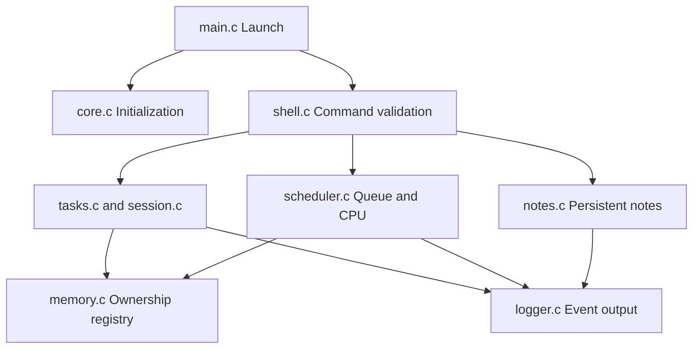
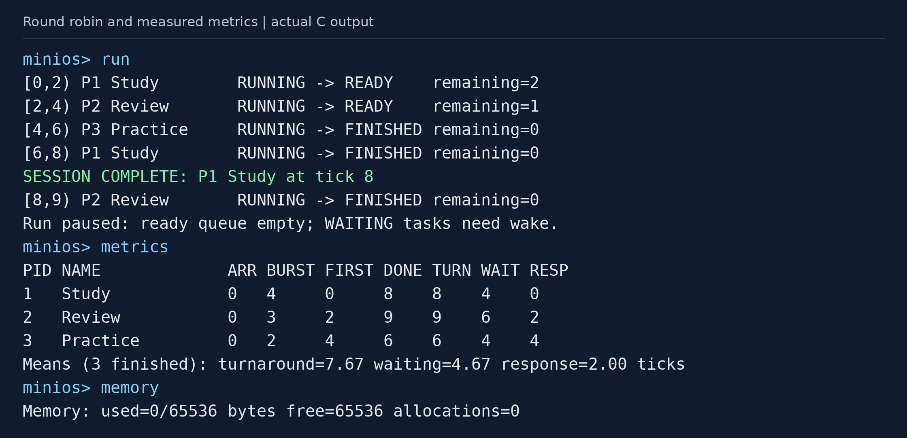
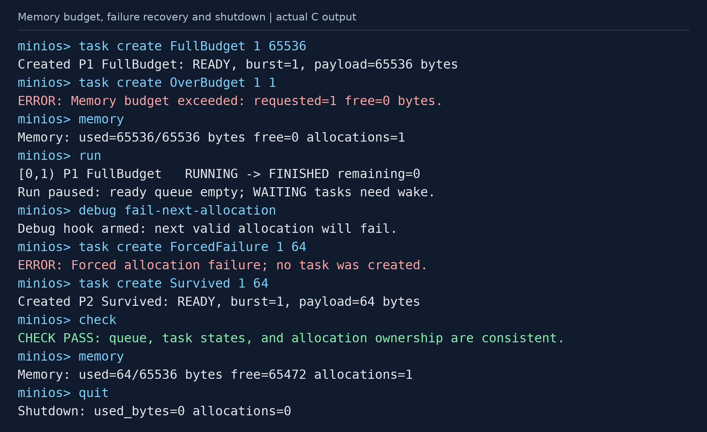
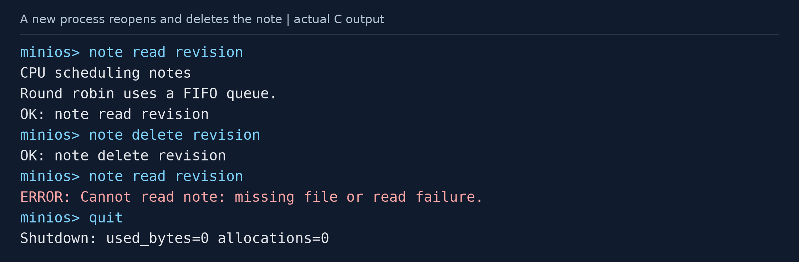

# MiniOS for a Study Room

**Operating Systems Project | Phase 2**

<<<<<<< HEAD
A C11 terminal application for simulated study tasks, round-robin scheduling,
task-owned memory, persistent revision notes, and study sessions.

## Team

| Name | KFUPM ID |
|---|---|
| Yasmeen Alshehri | 202271660 |
| Fatimah Alshehab | 202278660 |
| Raneem Alshahrani | 202277080 |
| Sarah Almas | 202261060 |

## Project status

The integrated core prototype is working. Overall project completion is estimated
at 70%; remaining work covers team acceptance checks, final report evidence,
peer review, and the demonstration. This is a planning estimate for the whole
project, rather than a measured percentage of source code.

## Files

| Location | Purpose |
|---|---|
| `src/` | Nine commented C implementation files. |
| `include/` | Eight commented headers containing interfaces and shared types. |
| `Makefile` | Build, run, and executable cleanup commands. |
| `README.md` | Project summary and build/run instructions. |

The progress report is supplied separately as an editable Word document.
=======
A modular **C11 terminal application** that connects familiar study activities to operating-system concepts. Users create study tasks, observe round-robin scheduling and task states, manage a limited payload-memory budget, save notes, and complete simulated study sessions.
>>>>>>> b50069e31a3c4a7842c97d49dd37e32c3b90fc94

**Current stage:** an integrated core prototype. The essential services are implemented and tested; team review and final validation on the team's computer remain.

<<<<<<< HEAD
Use Linux or Ubuntu through WSL, with GCC and GNU Make. The application uses
only the standard C library.

Extract the ZIP and open a terminal inside the `MiniOS_Phase2` folder:
=======
## Team Members

| Name | KFUPM ID |
|---|---|
| Yasmeen Alshehri | 202271660 |
| Fatimah Alshehab | 202278660 |
| Raneem Alshahrani | 202277080 |
| Sarah Almas | 202261060 |

## Table of Contents

1. [Project Overview](#project-overview)
2. [Implementation Progress](#implementation-progress)
3. [Requirements](#requirements)
4. [File Structure](#file-structure)
5. [Build and Run](#build-and-run)
6. [Usage and Commands](#usage-and-commands)
7. [Updated System Architecture](#updated-system-architecture)
8. [How It Works](#how-it-works)
9. [Reference Scheduling Example](#reference-scheduling-example)
10. [Validation and Test Results](#validation-and-test-results)
11. [Logging and Persistent Outputs](#logging-and-persistent-outputs)
12. [Console Evidence](#console-evidence)
13. [Makefile Targets](#makefile-targets)
14. [Cleanup and Error Handling](#cleanup-and-error-handling)
15. [Challenges and Remaining Work](#challenges-and-remaining-work)
16. [Phase 2 Submission](#phase-2-submission)

## Project Overview

Operating-system algorithms are easier to understand when their effects are visible. MiniOS uses a virtual study room to demonstrate how tasks compete for CPU time, change state, consume limited memory, and save data.

A study task is a C record with a simulated PID and a CPU burst. A round-robin scheduler shares one virtual CPU between READY tasks. Memory is allocated and released by a PID ownership registry. Revision notes are stored as text files, and a study-session task announces completion when its scheduled work finishes.

| Property | Implementation |
|---|---|
| Language | C11 and the standard C library |
| Interface | Single-user terminal commands |
| CPU model | One simulated CPU; sequential command processing |
| Scheduler | Round robin with a bounded circular FIFO ready queue |
| Task capacity | 20 retained records, including FINISHED tasks until reset |
| Task states | READY, RUNNING, WAITING, FINISHED |
| Time model | Virtual ticks; default quantum 2; zero modeled context-switch cost |
| Memory limit | 65,536 bytes of live task payloads |
| File service | Persistent notes using host-file I/O |
| Evidence | Event log, dispatch trace, metrics CSV, console captures, test results |

The scope is a teaching simulation running on an existing operating system. Real processes, parallel execution, a bootloader, kernel protection, paging, hardware drivers, networking, and a GUI are outside the agreed core scope. The payload budget excludes static records, buffers, logs, executable size, and C-library overhead.

## Implementation Progress

The current program combines task management, scheduling, memory accounting, notes, sessions, and logging in one working executable. Each module has commented source and a documented public interface. The code package also includes a Makefile, repeatable scenarios, direct C assertions, and an integration test runner.

| Source file | Implemented code | Purpose |
|---|---|---|
| `src/main.c` | `main` | Parse launch options, initialize shared state, start the shell. |
| `src/shell.c` | `shell_run`, command routing, strict integer parsing | Read complete commands, validate arguments, report errors, and return to the prompt safely. |
| `src/core.c` and `include/core.h` | `app_init`, `app_check`, `app_reset`, `app_shutdown` | Define shared structures and manage initialization, consistency checks, reset, and cleanup. |
| `src/tasks.c` | `task_create`, `task_find`, `task_block`, `task_wake`, `tasks_print` | Store task records and enforce legal state transitions. |
| `src/scheduler.c` | Queue operations, `scheduler_step`, `scheduler_run`, metric display/export | Implement FIFO round robin, virtual time, READY waiting, and completed-task metrics. |
| `src/memory.c` | `memory_allocate`, `memory_release`, `memory_clear`, `memory_check` | Enforce the payload budget and ownership rules; support allocation-failure testing. |
| `src/notes.c` | `note_create`, `note_append`, `note_read`, `note_delete` | Persist revision notes and detect file errors. |
| `src/session.c` | `session_start`, `session_complete` | Reuse task scheduling for study sessions and notify once on completion. |
| `src/logger.c` | `logger_open`, `logger_event`, `logger_close` | Append virtual-timestamped events and remember detected log failures. |

**Verified results:** all 12 defined integration cases and the direct C assertions pass. AddressSanitizer and UndefinedBehaviorSanitizer also pass with leak detection disabled. Full leak-tool checking, local terminal screenshots, member cross-review, and the final demonstration remain.

The application is written entirely in C. Python files are development tools for running tests and collecting evidence.

## Requirements

| Requirement | Use |
|---|---|
| Linux or Ubuntu through Windows Subsystem for Linux (WSL) | Agreed build and demonstration environment |
| GCC with C11 support | Compile the application and direct C tests |
| GNU Make | Run the supplied build, execution, and verification targets |
| Standard C library | Application functionality; no additional libraries need linking |
| Python 3 | Automated tests and evidence collection only |
| Writable runtime directory containing `notes/` | Store notes, logs, and CSV outputs |

The delivered build was verified with GCC 13.3.0 and Python 3.12 on Linux. Other environments should be checked by the team before submission.

## File Structure

| Location | Contents |
|---|---|
| `src/` | Nine C implementation files, separated by service responsibility. |
| `include/` | Eight headers containing public interfaces and shared types. |
| `tests/test_core.c` | Direct checks of scheduling, queue order, ownership, and cleanup. |
| `tests/run_tests.py` | T1-T12 integration runner; writes CSV/JSON results. |
| `tests/collect_evidence.py` | Executes the demo scenarios and records their actual output. |
| `tests/*.txt` | Repeatable command files for scheduling, resources, notes, and five tasks. |
| `data/notes/` | Runtime notes; initially empty. |
| `evidence/` | Recorded transcripts, example runtime files, results, and console images. |
| `docs/ARCHITECTURE.md` | Detailed structures, interfaces, state transitions, and design decisions. |
| `docs/CODE_GUIDE.md` | Suggested reading order and function/module map. |
| `docs/TEAM_REVIEW.md` | Proposal responsibilities and remaining review plan. |
| `docs/MiniOS_Phase2_Progress_Report.pdf` | PDF progress report accompanying the code. |
| `START_HERE.md` | Short navigation and run instructions. |
| `Makefile` | Commented build, run, test, sanitizer, and cleanup targets. |
| `README.md` | Project overview, current progress, architecture, and user instructions. |

## Build and Run

Extract the ZIP and open a terminal **inside the `MiniOS_Phase2` folder**:
>>>>>>> b50069e31a3c4a7842c97d49dd37e32c3b90fc94

```sh
make
make run
```

<<<<<<< HEAD
The program displays `minios>`. Enter `help` to see its commands. Run `make`
commands in the host terminal; enter the commands below inside MiniOS.
=======
`make run` creates `data/notes` if needed, then starts the application. The normal build uses:

```text
-std=c11 -O2 -Wall -Wextra -Wpedantic -Werror
```

To compile without Make:
>>>>>>> b50069e31a3c4a7842c97d49dd37e32c3b90fc94

## Commands

<<<<<<< HEAD
| Command | Purpose |
|---|---|
| `task create NAME BURST BYTES` | Create a READY task. |
| `session start NAME TICKS BYTES` | Create a study-session task. |
| `tasks` | Show task records and ready-queue order. |
| `block PID` / `wake PID` | Move a task between READY and WAITING. |
| `quantum N` | Set the time quantum for future slices. |
| `step` / `run` | Execute one slice / execute until no READY task remains. |
| `metrics` / `export` | Show completed-task metrics / save them as CSV. |
| `memory` | Show current payload bytes and allocation count. |
| `note create NAME TEXT` | Create a new note without replacing an existing one. |
| `note append NAME TEXT` | Append a line to an existing note. |
| `note read NAME` / `note delete NAME` | Read or delete a note. |
| `check` | Check queue and memory consistency. |
| `reset` | Release payloads, clear task records, and reset the virtual clock. |
| `debug fail-next-allocation` | Demonstrate safe handling of an allocation failure. |
| `help` / `quit` | Show commands / clean up and exit. |

Names use 1-48 ASCII letters, digits, underscores, or hyphens. Bursts and quantum
are positive integers up to 1,000,000. Task records are limited to 20, including
finished records until reset. Each payload is 1-65,536 bytes, subject to the total
65,536-byte budget. Time is measured in virtual ticks. Note text can contain spaces.

## Quick example
=======
`make` and `gcc` are host-terminal commands. After the program displays `minios>`, enter the MiniOS commands listed below.

### Launch options

```text
./minios [--batch] [--data-dir DIRECTORY]
```

| Option | Meaning |
|---|---|
| `--batch` | Read commands from standard input and echo them for recorded evidence. |
| `--data-dir DIRECTORY` | Use a different existing directory for runtime outputs and notes. |

For a separate experiment:

```sh
mkdir -p my_run/notes
./minios --data-dir my_run
```

The selected runtime directory must exist before startup. Ordinary note commands also need its `notes/` subdirectory.

## Usage and Commands

| Command | Behavior |
|---|---|
| `task create NAME BURST BYTES` | Create a READY task after successful payload allocation and queue insertion. |
| `session start NAME TICKS BYTES` | Create a study task with a one-time completion notice. |
| `tasks` | Display retained task records and FIFO ready-queue order. |
| `block PID` | Move a READY task to WAITING and remove it from the queue. |
| `wake PID` | Move a WAITING task to READY at the queue tail. |
| `quantum N` | Change the quantum used by future dispatches. |
| `step` | Execute one round-robin slice. |
| `run` | Execute until no READY task remains. WAITING tasks stay blocked. |
| `metrics` | Display final metrics for FINISHED tasks. |
| `export` | Write those metrics to the selected runtime directory's `metrics.csv`. |
| `memory` | Display current live bytes, free budget, and allocation count. |
| `note create NAME TEXT` | Create a new note without overwriting an existing one. |
| `note append NAME TEXT` | Add one newline-terminated text line to an existing note. |
| `note read NAME` | Print a saved note. |
| `note delete NAME` | Remove a saved note. |
| `check` | Check queue membership, task state relationships, ownership, and memory totals. |
| `reset` | Release payloads; clear records, PIDs, and clock; retain notes and quantum. |
| `debug fail-next-allocation` | Force the next otherwise valid task allocation to fail. |
| `help` | Show command syntax. |
| `quit` | Release outstanding payloads, close files, and exit. EOF also cleans up. |

### Input limits

| Field | Accepted values |
|---|---|
| Task or note name | 1-48 ASCII letters, digits, underscores, or hyphens |
| Burst or quantum | Positive integer from 1 to 1,000,000 virtual ticks |
| One payload | 1-65,536 bytes, within the remaining total budget |
| Task records | At most 20, including completed records until reset |
| Complete command line | At most 2,046 bytes; an oversized line is discarded in full |

Names cannot contain spaces or path separators. Note text can contain spaces. Large bursts with quantum 1 generate many trace entries; small teaching workloads are easier to inspect.

## Updated System Architecture



The arrows show the main request paths and selected service dependencies. `main.c` initializes the app before starting the shell. Modules share the `App` model from `core.h`. The shell also invokes core consistency checks, reset, and shutdown. Detailed interfaces are documented in [the architecture notes](docs/ARCHITECTURE.md).

### Updates from the proposal

| Refinement | Current implementation |
|---|---|
| Shared core made explicit | Added `core.c/core.h` for shared structures, initialization, reset, checks, and cleanup. |
| Queue placement | Circular FIFO operations are implemented inside `scheduler.c`. |
| Event representation | Events are written directly to the log; a separate in-memory `Event` structure is not maintained. |
| Test support | Python scripts run tests and capture evidence separately from the C application. |

### Shared data structures

| Structure | Information stored |
|---|---|
| `Task` | PID, name, state, burst/remaining work, timestamps, READY waiting, payload alias/size, session flags. |
| `ReadyQueue` | Circular array of PIDs, head index, and active count. |
| `AllocationRecord` | Registry-owned pointer, owner PID, and payload byte count. |
| `Memory` | Allocation registry, live totals, and forced-allocation-failure flag. |
| `App` | Task table, queue, clock, quantum, experiment number, services, streams, and error buffer. |
| `Logger` | Owned event stream and detected I/O-failure count. |

## How It Works

### Task creation

1. Validate the name, burst, requested bytes, and record capacity.
2. Ask the memory registry to allocate the payload for a candidate PID.
3. Add that PID to the ready queue.
4. Commit the task record and advance `next_pid` only after the preceding steps succeed.

A failed allocation creates no partial record and consumes no PID. If queue insertion fails, the allocated block is released before returning an error.

### Round-robin execution

1. Remove the oldest READY PID from the FIFO queue and mark it RUNNING.
2. Choose `slice = min(quantum, remaining)` and record the first-run time if unset.
3. Add the slice to the waiting counter of every other READY task. WAITING tasks receive no READY waiting ticks.
4. Advance the virtual clock and subtract the executed work.
5. If work remains, return the task to READY at the tail. Otherwise, mark it FINISHED, record completion, and release its payload.
6. Record the slice and emit a study-session completion notice if appropriate.

An empty ready queue produces an idle result without advancing virtual time. There is no modeled context-switch cost.

### State transitions

| Trigger | Transition | Queue effect |
|---|---|---|
| Successful create | New record to READY | Append PID. |
| Dispatch | READY to RUNNING | Pop head. |
| Unfinished slice | RUNNING to READY | Append PID at tail. |
| Work finishes | RUNNING to FINISHED | Remain absent; free payload. |
| Manual block | READY to WAITING | Remove PID. |
| Manual wake | WAITING to READY | Append once at tail. |

Commands execute between slices. Blocking is an explicit simulation rather than an asynchronous host I/O operation.

### Memory ownership

The memory registry owns every task payload and is the only module that calls `free` on those blocks. `Task.payload` aliases its registry entry. Completion releases one PID; reset and exit release all remaining blocks. A second release finds no live record and cannot free the pointer again.

FINISHED task records keep their result data until reset. Their table's BYTES column shows the original request; the `memory` command shows current live allocations.

### Notes and study sessions

Notes use standard C `fopen`, `fgets`, `fputs`, `fclose`, and `remove`. Create uses exclusive mode to preserve an existing note; append requires an existing readable file. A detected write or close failure is reported, though content may be partial because writes are not transactional. The notes directory is trusted local storage.

A study session is a normal scheduled task with a session flag. Completion is announced only when it becomes FINISHED and has not already been notified. Session duration is virtual CPU work, not actual minutes.

## Reference Scheduling Example

Enter these commands at `minios>` in a fresh experiment:
>>>>>>> b50069e31a3c4a7842c97d49dd37e32c3b90fc94

```text
session start Study 4 256
task create Review 3 128
task create Practice 2 64
run
metrics
memory
quit
```

<<<<<<< HEAD
With quantum 2, dispatch order is P1, P2, P3, P1, P2; execution ends at tick 9.

## Runtime files and cleanup

`make run` creates `data/notes/` automatically. Notes, `data/events.log`, and
`data/trace.csv` are created during use; `export` writes `data/metrics.csv`.
These are application outputs and are not included in this source ZIP.

Notes survive reset and restart; task records and the clock do not survive a
restart. `quit` and EOF free outstanding payloads and close files. `make clean`
removes the executable and preserves saved notes and other runtime outputs.
=======
All three tasks arrive at tick 0. With the default quantum 2, the recorded trace is:

| Interval | Task | Remaining after slice |
|---|---|---|
| 0-2 | P1 Study | 2 |
| 2-4 | P2 Review | 1 |
| 4-6 | P3 Practice | 0 |
| 6-8 | P1 Study | 0 |
| 8-9 | P2 Review | 0 |

| Task | Burst | First run | Completion | Turnaround | READY waiting | Response |
|---|---|---|---|---|---|---|
| P1 | 4 | 0 | 8 | 8 | 4 | 0 |
| P2 | 3 | 2 | 9 | 9 | 6 | 2 |
| P3 | 2 | 4 | 6 | 6 | 4 | 4 |

- **Turnaround** = completion - arrival.
- **Response** = first run - arrival.
- **Waiting** = accumulated ticks in READY. With no blocking, this also equals turnaround - burst; blocked time must be excluded when blocking occurs.

Measured means are **7.67 turnaround**, **4.67 READY waiting**, and **2.00 response** ticks. The Study session announces completion once at tick 8. Execution ends at tick 9 with zero live payload allocations.

To run a saved scenario from the host terminal:

```sh
./minios --batch < tests/reference.txt
./minios --batch < tests/five_tasks.txt
./minios --batch < tests/resources.txt
```

Each command above starts a new process, so task records and the virtual clock start fresh. `tests/notes_first.txt` and `tests/notes_restart.txt` provide a two-process persistence demonstration; use a fresh note name/directory before replaying them.

## Validation and Test Results

```sh
make test
make sanitize
```

The standard suite and ASan/UBSan suite each passed all 12 defined integration cases and the direct C assertions on 4 November 2026. The warning-free GCC build treats warnings as errors.

| Test | Checked behavior | Result |
|---|---|---|
| T1 | Exact reference schedule, per-task metrics, and means. | PASS |
| T2 | Note creation, append, exact bytes after restart, and deletion. | PASS |
| T3 | WAITING tasks excluded; waking appends once. | PASS |
| T4 | Empty system, one task, and a burst shorter than the quantum. | PASS |
| T5 | First 20 task records accepted; record 21 rejected. | PASS |
| T6 | Exact 65,536-byte budget; extra byte rejected; memory reclaimed. | PASS |
| T7 | Invalid numeric/name/range input and oversized commands rejected. | PASS |
| T8 | Missing/read/path/open/write failures reported with safe recovery. | PASS |
| T9 | Unknown PIDs and invalid state transitions rejected. | PASS |
| T10 | Forced allocation failure leaves no partial task or consumed PID. | PASS |
| T11 | Completion, reset, and exit release all tracked payloads. | PASS |
| T12 | Study-session completion notice/event occurs exactly once. | PASS |

The C assertions additionally check circular-queue wraparound, removal across a wrapped queue, late arrivals, READY-only waiting, allocation rollback, and harmless repeat release. The shell checks shared-state consistency after every executed command.

Results are stored in [the standard test table](evidence/test_results.csv), [the standard JSON results](evidence/test_results.json), and [the sanitizer JSON results](evidence/test_results_sanitizer.json). Tests use temporary directories and leave user notes untouched. A Linux `/dev/full` fixture exercises buffered write failure; the runner reports when that fixture is unavailable on another host.

### Full leak checking

On a compatible Linux/WSL host, also run:

```sh
make leak-check
```

LeakSanitizer could not inspect `/proc/PID/task` in the preparation environment. Its original diagnostic is retained in `evidence/leak_check_unavailable.json`; no successful full leak-tool result is claimed. `make sanitize` therefore uses `detect_leaks=0`. Registry checks and direct assertions independently verify zero tracked task payloads after completion, reset, and exit.

## Logging and Persistent Outputs

Default paths are relative to the working directory. `--data-dir` changes their common parent.

| Output | Behavior |
|---|---|
| `data/notes/NAME.txt` | Notes persist across restart and reset. |
| `data/events.log` | Append-only event log with START and SHUTDOWN boundaries. |
| `data/trace.csv` | Replaced at startup; slices carry an experiment number to distinguish resets. |
| `data/metrics.csv` | Replaced by `export`; contains finished tasks in the current experiment. |

Example recorded event lines:

```text
experiment=1 tick=0 event=CREATE pid=1 state=READY burst=4 bytes=256 used_bytes=256 session=1
experiment=1 tick=8 event=SESSION_COMPLETE pid=1 Study
experiment=1 tick=9 event=SHUTDOWN pid=0 used_bytes=0 allocations=0
```

Event fields are experiment, virtual tick, event name, PID, and detail. PID 0 denotes an application/file event. Task records, PID numbering, and the clock do not persist across process restarts. `reset` retains notes and quantum, starts a new experiment number, and clears current task metrics.

## Console Evidence

The images below are faithful renderings of actual recorded C-program output. The corresponding original transcripts, logs, and CSV files are in `evidence/`.

### Reference schedule and measured metrics



### Memory budget and allocation failure recovery



### Notes reopened in a new process



Additional evidence covers task blocking/waking, five-task scheduling, and the complete test-suite summary. Capture screenshots from the team's local terminal run for the submission report.

## Makefile Targets

| Target | Purpose |
|---|---|
| `make` / `make all` | Build the `minios` terminal executable. |
| `make run` | Build, ensure `data/notes/` exists, and start interactive mode. |
| `make test` | Build and run T1-T12 plus direct C assertions. |
| `make sanitize` | Build and run ASan/UBSan checks with leak detection disabled. |
| `make leak-check` | Run sanitizer checks and then enable full leak detection on a supported host. |
| `make clean` | Remove generated application/test executables; preserve source, notes, docs, and evidence. |

## Cleanup and Error Handling

`quit` and EOF release outstanding payloads, log zero tracked allocations, and close owned files. `reset` frees payloads and clears task records before starting another experiment. FINISHED task payloads are freed as soon as their work completes.

Malformed commands, illegal transitions, budget exhaustion, failed allocations, and detected note-file errors report a reason and return control to the prompt. A failed internal consistency check exits after cleanup. Event/trace I/O failures warn on standard error and produce a nonzero final exit status.

## Challenges and Remaining Work

| Challenge | Current resolution |
|---|---|
| Keeping task states and queue order consistent | Shared structures, unique queue entries, legal block/wake rules, and checks between commands. |
| Recovering from memory-allocation failure | Allocate before committing task/PID state; roll back queue failure; test forced NULL allocation. |
| Correct waiting-time accounting | Count READY ticks directly, excluding time spent WAITING. |
| Avoiding partial commands and hidden file failures | Drain oversized input; validate complete arguments; check buffered writes and closes. |
| Host-dependent verification | Retain the unavailable LeakSanitizer diagnostic and rerun full leak checking on the team machine. |

### Remaining work

1. Build and run the package on the agreed team computer; review another member's module.
2. Repeat standard and sanitizer checks, run full leak checking on a supported host, and record actual local results.
3. Add local terminal screenshots and complete the final demonstration and documentation.
4. Confirm the team details and record actual individual contributions and peer reviews.

The core implementation is working. These remaining activities cover team review, local verification, and final delivery. Additional algorithms, persistent tasks, or real-time timers can be considered later without delaying the agreed core.

Proposal responsibilities are Yasmeen for CLI/tasks, Fatimah for memory, Raneem for scheduling/metrics, and Sarah for notes/sessions/logs/evidence. These assignments are not a verified record of completed individual authorship. See [the team review plan](docs/TEAM_REVIEW.md).

## Phase 2 Submission

The announcement requires **a PDF progress report** and **organized C source code as a ZIP or GitHub repository**. This README documents the code and supports the report; keep the required PDF in the submission.

The PDF should cover the project recap, implementation progress, updated architecture, working-system screenshots, challenges, and remaining-work plan. The submission deadline is **10 November 2026**, with one submission per group.

Related documentation: [architecture notes](docs/ARCHITECTURE.md), [source code guide](docs/CODE_GUIDE.md), [quick start](START_HERE.md), and [PDF progress report](docs/MiniOS_Phase2_Progress_Report.pdf).
>>>>>>> b50069e31a3c4a7842c97d49dd37e32c3b90fc94
